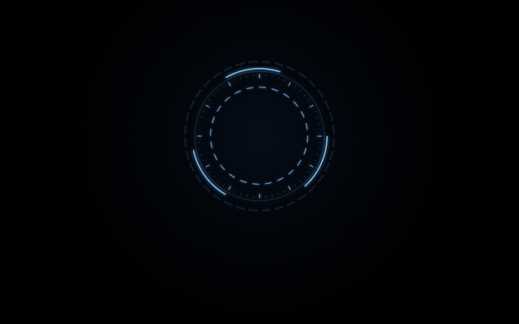
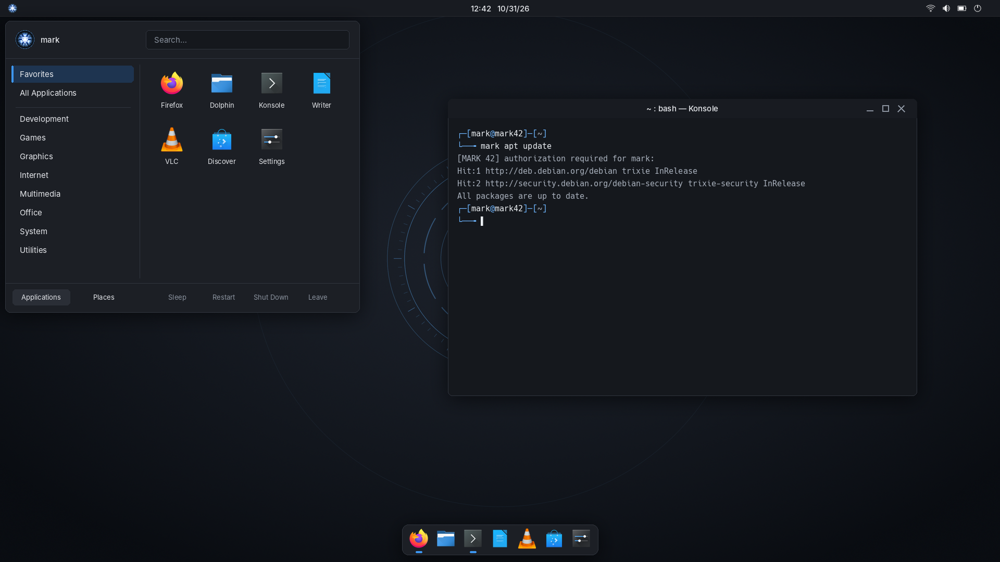
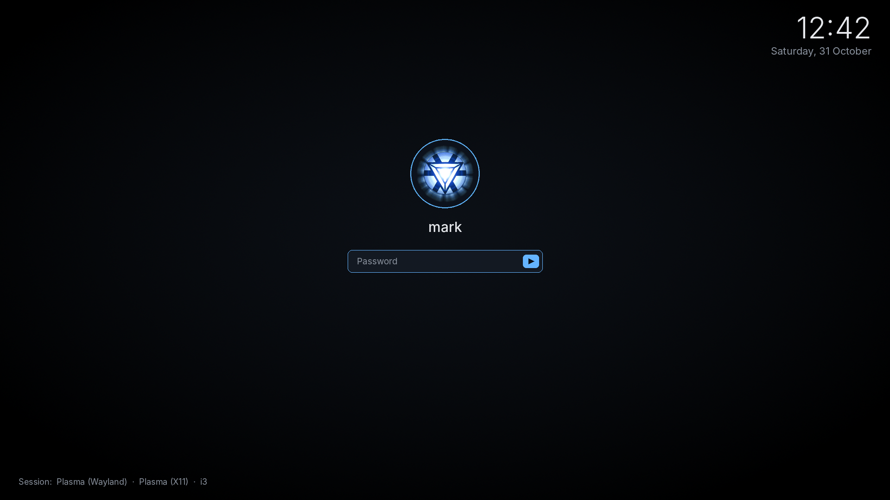
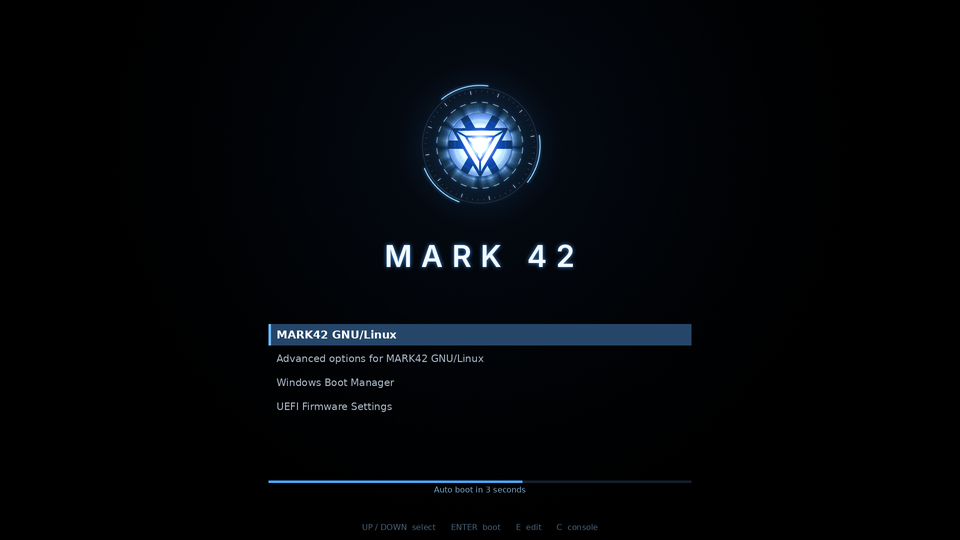
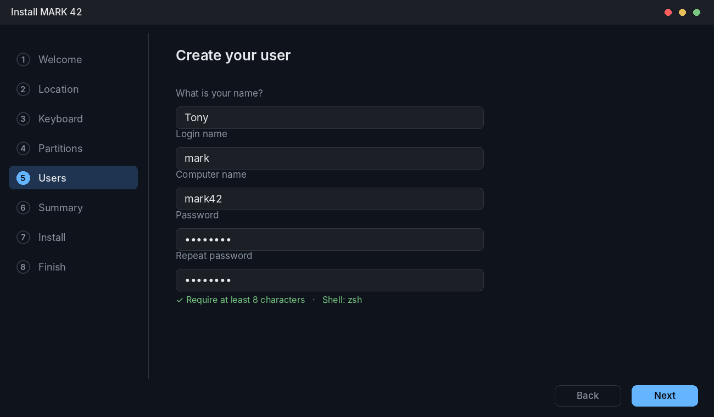
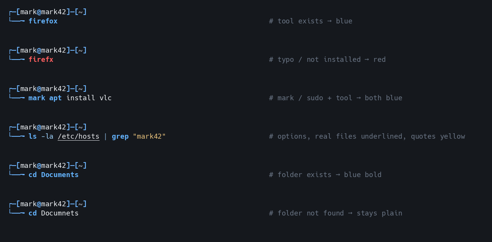
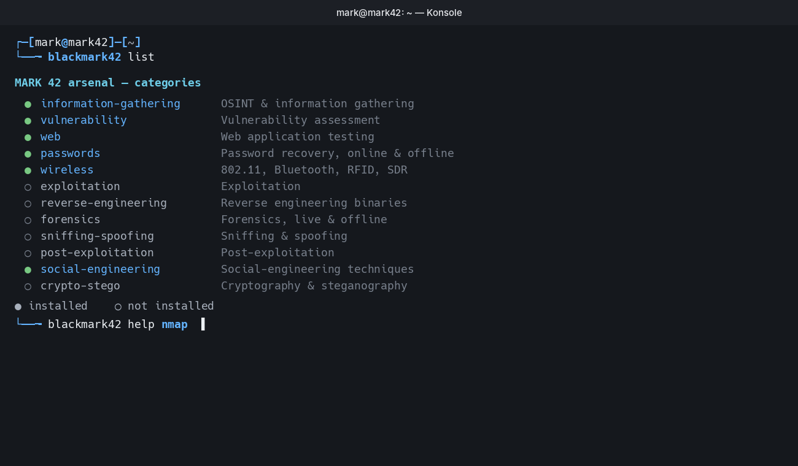

<div align="center">



# MARK 42

**An Iron Man inspired Linux distribution, built on Debian 13 (trixie).**

Clean graphite desktop · arc-reactor boot animation · dual-boot installer · offline AI assistants


</div>

> **Fan project.** MARK 42 is an unofficial, non-commercial fan-made Linux distribution.
> It is not affiliated with, endorsed by, or sponsored by Marvel, Disney, or any of their
> subsidiaries. "Iron Man", "MARK 42", "JARVIS", "Ultron", the arc reactor and related names
> and imagery are trademarks of their respective owners and are used here for fan purposes only.

---

## Contents

- [Why MARK 42](#why-mark-42)
- [Screenshots](#screenshots)
- [Features](#features)
- [Built-in tools](#built-in-tools)
- [System requirements](#system-requirements)
- [Build the ISO](#build-the-iso)
- [Try it in a virtual machine](#try-it-in-a-virtual-machine)
- [Install on a real PC (dual boot)](#install-on-a-real-pc-dual-boot)
- [After installing](#after-installing)
- [Project layout](#project-layout)
- [Customizing](#customizing)
- [Troubleshooting](#troubleshooting)
- [Contributing](#contributing)
- [License](#license)

---

## Why MARK 42

MARK 42 looks like it came out of Tony Stark's workshop, but it is **pure Debian** underneath.

- **Every Debian command and guide works.** `apt`, `dpkg`, `systemctl`, and Debian packages all work as usual.
- **Stable base, fresh apps.** Debian 13 stable plus backports, Flatpak and Flathub.
- **Installs like a normal OS** and keeps your data. It also runs as a live USB.
- **Dual boot built in.** Choose *Install alongside* to keep Windows or another Linux.
- **Private by default.** The AI assistants run fully offline on your own machine.

## Screenshots

| Desktop | Login |
|---|---|
|  |  |
| **GRUB boot menu** | **Installer** |
|  |  |
| **Terminal** | **blackmark42 arsenal** |
|  |  |

More in [`preview/`](preview/), including the full tour (`mark42-full-tour.png`) and the login splash animation.

## Features

### Look and feel
- **KDE Plasma 6** with a thin solid top bar (MARK 42 menu, clock, tray) and a floating icon dock that moves out of the way of windows.
- **Graphite colors with an arc-reactor accent**, Breeze Dark icons and the Inter font.
- **Arc-reactor Plymouth boot animation**, full resolution from the first frame (early KMS).
- **Matching theme everywhere:** GRUB menu, SDDM login screen, Plasma splash, Konsole profile and installer.
- The original red glowing wallpaper is included as `/usr/share/backgrounds/mark42/mark42-classic-glow.png`.

### Desktop sessions
Choose a session on the login screen:
- **Plasma (Wayland)**: the default.
- **Plasma (X11)**
- **i3**: a keyboard-driven tiling session with Rofi, a Conky HUD and a power menu.

### Software included
| Category | Apps |
|---|---|
| Office | LibreOffice (Writer, Calc, Impress) |
| Media | VLC |
| Backup | Timeshift (system snapshots) |
| App store | Discover with Flatpak + Flathub |
| Gaming | One-click Steam installer, controller support |
| Printing | CUPS + KDE print manager |
| Hardware | All firmware, CPU microcode, kernel headers, build tools |

### Security and performance
- **Firewall on by default** (ufw, managed from System Settings).
- **AppArmor**, kernel sysctl hardening and automatic security updates (unattended-upgrades).
- **8-character minimum password** in the installer.
- **zram** compressed swap, Baloo file indexing off, and no services left listening on the network.
- **Secure Boot works**: MARK 42 uses Debian's signed shim, GRUB and kernel.

## Built-in tools

### `mark` and `mark42`: root access

| Command | What it does | Same as |
|---|---|---|
| `mark <command>` | Runs one command as root, e.g. `mark apt install vlc` | `sudo <command>` |
| `mark42` or `mark 42` | Full root shell with a red **MARK 42 :: ROOT** prompt. Type `exit` to leave | `sudo -i` |
| `sudo …` | Still works, so every Debian guide works unchanged | — |

Both commands ask for your own password and only work for users in the `sudo` group, so they are exactly as secure as `sudo`. Tab-completion works after `mark`.

### `jarvis`: offline voice assistant

JARVIS listens, talks back through your speakers and can run commands for you. It is **fully offline**: speech recognition by Vosk, voice by eSpeak-NG, and the same local AI engine as Ultron.

```bash
jarvis setup          # one-time download of the voice parts (needs internet once)
jarvis                # start listening, then say "Jarvis, ..."
jarvis ask "what's my IP address?"
jarvis say "Good evening"
jarvis voice en-gb    # change the voice
jarvis status | stop | help
```

- JARVIS greets you by name when you log in. It **does not** start listening until you run `jarvis`.
- Commands that could destroy data (`rm -rf /`, `mkfs`, `dd` to a disk, …) are refused.
- Everything is stored in `/opt/mark42/jarvis`.

### `ultron`: offline AI chat

A local AI chatbot powered by [Ollama](https://ollama.com). Nothing leaves your machine.

```bash
ultron                     # chat (installs Ollama and the model on first run, a few GB)
ultron model <name>        # switch model, e.g. llama3
ultron models              # list downloaded models
ultron update              # update the current model
ultron rm <name>           # delete a model
ultron status | stop | help
```

The Ollama server only starts when needed and listens on `127.0.0.1`, so it is never exposed to the network. Models are stored in `/opt/mark42/ultron`.

### `blackmark42`: security arsenal

Installs Kali Linux tool collections on MARK 42 while keeping the Debian base.

```bash
blackmark42             # install every category
blackmark42 web         # or just one: web, passwords, wireless, forensics, ...
blackmark42 list        # all categories and what's installed
blackmark42 tools web   # tools a category installed
blackmark42 help nmap   # description, --help and man page for one tool
```

On first run it adds Kali's signed repository and **pins it at a low priority**, so Kali packages are only used for the tools you ask for and never replace the Debian base. Mixing in Kali packages still carries some risk, so install only the categories you need.

### More helpers

| Command | What it does |
|---|---|
| `mark42-nvidia` | Installs and sets up the NVIDIA driver on real hardware, including Secure Boot key signing (one-time setup) |
| `prime-run <app>` | Runs an app on the NVIDIA GPU on hybrid-graphics laptops |
| `mark42-install-steam` | Installs Steam from Flathub (also in Menu → Games) |
| `mark42-conky` | Starts the Iron Man style Conky system monitor |
| `mark42-power` | Rofi power menu (lock, log out, reboot, shut down) |

## System requirements

| | Minimum | Recommended |
|---|---|---|
| CPU | 64-bit (amd64), 2 cores | 4 cores or more |
| RAM | 4 GB | 8 GB or more (16 GB for Ultron/JARVIS with bigger models) |
| Disk | 30 GB | 60 GB or more |
| Firmware | BIOS or UEFI (Secure Boot supported) | UEFI |
| GPU | Any with KMS support (Intel, AMD, NVIDIA via nouveau) | NVIDIA cards: run `mark42-nvidia` after installing |

## Build the ISO

You need a **Debian 13 or Kali** machine (or VM), about **20 GB free disk space**, and internet.

```bash
sudo apt install live-build git
git clone https://github.com/<your-user>/mark42.git
cd mark42
sudo ./build.sh
```

- The first build takes **30–60 minutes** and downloads about 1.5 GB.
- Result: `MARK42-1.0-amd64.iso` (about 3 GB) plus a `.sha256` checksum file.
- The full log is written to `build.log`.
- To rebuild from scratch: `sudo ./build.sh --clean`. Downloaded packages are kept in `cache/`, so rebuilds are faster.

> **Tip:** if you build inside a VM, make sure the clock is correct. A wrong clock makes apt reject package signatures. `build.sh` checks this for you.

## Try it in a virtual machine

Always test the ISO in a VM before installing it on real hardware.

**VirtualBox settings:**
1. New VM → Type **Linux**, Version **Debian (64-bit)**.
2. **4 GB RAM** or more, **2+ CPUs**, **30 GB** disk.
3. *Display*: graphics controller **VMSVGA**, **128 MB** video memory, **Enable 3D Acceleration**. Without these the desktop feels slow.
4. *System → Enable EFI* to test the UEFI path most PCs use. Also test once without it (BIOS).
5. *Audio → Enable audio input* if you want to try JARVIS.

Boot the ISO, look around, then run **Install MARK 42** from the desktop.

**Live session login:** user `mark`, password `live`.

## Install on a real PC (dual boot)

1. **Back up your important files.**
2. **Windows only:**
   - Turn off *Fast Startup* (Control Panel → Power Options → *Choose what the power buttons do*).
   - If BitLocker is on, **save your recovery key** and suspend BitLocker.
3. *(Optional)* Shrink the Windows partition in *Disk Management* to free 50 GB or more.
4. Write the ISO to a USB stick with **[Rufus](https://rufus.ie)** (GPT / UEFI) or **[Ventoy](https://www.ventoy.net)**.
5. Boot from the USB (press F12, F11, Esc or F2 at power-on, depending on your PC).
6. Run **Install MARK 42**. On the Partitions page choose **Install alongside** (or use the free space).
7. Reboot. The GRUB menu shows **MARK42 GNU/Linux** and **Windows Boot Manager**.

Secure Boot normally works. If your PC refuses to boot the USB, turn Secure Boot off in the BIOS.

## After installing

- **Update:** `mark apt update && mark apt full-upgrade`
- **Snapshots:** open **Timeshift** once and schedule daily snapshots.
- **Apps:** open **Discover**, or use `flatpak search <app>` and `flatpak install flathub <id>`.
- **Newer packages:** `mark apt install -t trixie-backports <package>` (for example `linux-image-amd64` for a newer kernel).
- **NVIDIA GPU:** run `mark42-nvidia`.
- **i3 keys:** Super+Enter opens a terminal, Super+D the app launcher, Super+F1 the full cheat sheet.
- **Dotfiles:** all settings are plain text files in `~/.config/`.

## Project layout

| Path | What it is |
|---|---|
| `build.sh` | One-command ISO build (live-build) with clock and disk-space checks |
| `art/gen_boot_clean.py` | Turns `art/source/arc-reactor.jpg` into the logo, boot animation, GRUB theme, live splash, installer art, icons and avatar |
| `art/gen_clean_wallpaper.py` | Draws the line-art wallpaper and login background in every size |
| `art/gen_kde_colors.py` | Writes the `Mark42` KDE color scheme |
| `art/gen_previews.py` | Renders the images in `preview/` and the theme thumbnails (needs `build/chroot`, the Inter font and cairosvg) |
| `art/gen_assets.py` | Old red generator, retired: running it now runs the current generators |
| `preview/` | Screenshots, mock-ups and boot/login animations |
| `overlay/package-lists/` | Packages installed in the OS (`mark42.list.chroot`) and stored on the ISO for offline GRUB install (`installer-*.list.binary`) |
| `overlay/hooks/live/0500-mark42.hook.chroot` | Branding and hardening applied inside the image |
| `overlay/includes.chroot_after_packages/` | Files copied into the OS: Plymouth, GRUB, Plasma look-and-feel, SDDM, Konsole, Calamares branding, and the tools in `usr/local/bin/` |

## Customizing

- **Logo:** replace `art/source/arc-reactor.jpg`, run `python3 art/gen_assets.py` and rebuild. The crop centre is set in `make_logo()`.
- **Apps:** edit `overlay/package-lists/mark42.list.chroot` (one Debian package per line).
- **Colors:** edit and run `art/gen_kde_colors.py`, or change them later in *System Settings → Colors & Themes*.
- **Boot animation:** speed and size are set in `overlay/includes.chroot_after_packages/usr/share/plymouth/themes/mark42/mark42.script`.
- **Preview the boot splash on an installed system** without rebooting:
  ```bash
  sudo plymouthd; sudo plymouth --show-splash; sleep 8; sudo plymouth quit
  ```

## Troubleshooting

| Problem | Fix |
|---|---|
| Build fails with signature or "not yet valid" errors | Your clock is wrong. Fix the date and time, then rebuild |
| Build stops early with no error | Check free disk space (about 20 GB needed) and look at `build.log` |
| Desktop is slow in VirtualBox | Use VMSVGA, enable 3D acceleration, 128 MB video memory, 2+ CPUs |
| PC boots to `grub rescue` | Turn Secure Boot off once, boot MARK 42, run `mark apt full-upgrade`, then turn it back on |
| NVIDIA driver not working | Run `mark42-nvidia`. If the driver fails to build, run `mark apt full-upgrade` and try again. The desktop keeps running on the integrated GPU meanwhile |
| JARVIS can't hear you | Check the microphone in *System Settings → Sound*. In a VM, enable audio input |
| "MARK 42" name changed back to Debian after an upgrade | `apt full-upgrade` can reset `/etc/os-release`. The theme, boot animation and GRUB are not affected |

## Contributing

Issues and pull requests are welcome.

1. Fork the repo and create a branch: `git checkout -b my-change`
2. Make your change.
3. Test it: `sudo ./build.sh --clean`, then boot the ISO in a VM with **both BIOS and UEFI**.
4. Open a pull request describing what you changed and how you tested it.

Bug reports are most useful with your hardware, BIOS/UEFI mode and the relevant part of `build.log` or `journalctl -b`.

## License

MARK 42's build scripts, configuration and artwork generators are released under the
**GNU General Public License v3.0**; see [`LICENSE`](LICENSE).

The Debian packages included in the ISO keep their own licenses. Iron Man, MARK 42, JARVIS,
Ultron and the arc reactor are trademarks of Marvel / Disney; this project is an unofficial fan work.

<div align="center">

**"Sometimes you gotta run before you can walk."**

</div>
